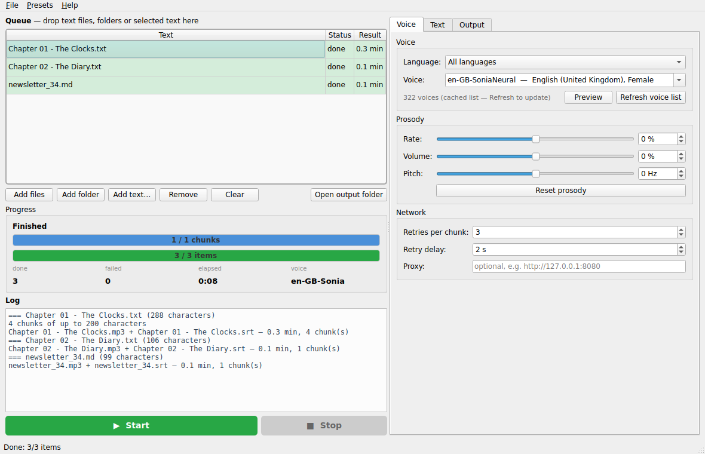

# edge-tts-gui

Batch **text-to-speech** with Microsoft Edge's neural voices (via [edge-tts](https://github.com/rany2/edge-tts)).
Drop text files in, pick a voice, press *Start* — you get `mp3` / `wav` / `ogg` / `flac` / `m4a` next to each file,
with `srt` / `vtt` subtitles that stay in sync even for book-length texts. Free, no API key.



## Features

- **Queue** of text files (`.txt .md .rst .log .html .srt`) or pasted text; add files, folders (recursive) or drag & drop;
  per-item status, progress, elapsed time, log
- **322 voices** in 70+ languages, filterable by language; *Preview* speaks a sample with the current settings
- **Prosody**: rate, volume, pitch sliders
- **Long texts**: split at sentences / paragraphs / lines into chunks the service accepts, synthesized with retries,
  joined into one file; optional pause between chunks; subtitle timestamps shifted per chunk so they never drift
- **Subtitles**: sentence- or word-level cues, `srt`, `vtt` or both
- **Output**: next to the source or into a folder, suffix, overwrite guard; non-mp3 formats via FFmpeg
- Encoding auto-detection (UTF-8, cp1250, cp1252), HTML stripped to text, `.srt` input loses its timestamps
- **Presets** menu (Audiobook / Video voice-over / Quick listen, save / load / import / export, user defaults),
  settings remembered between runs, proxy support
- Cross-platform: Windows, Linux, macOS

## Install

Prebuilt binaries (no Python needed): [latest release](https://github.com/hclivess/edge-tts-gui/releases/latest).

From source:

```
pip install -r requirements.txt
python main.py          # run.cmd / run.sh do the same
```

Optional: [FFmpeg](https://ffmpeg.org/) in `PATH` or next to the app — needed only for wav / ogg / flac / m4a output and
for the *pause between chunks* option. Synthesis happens on Microsoft's servers, so you need internet access.

## Settings

| Tab | |
|---|---|
| **Voice** | language filter, voice, preview, refresh voice list (cached in `presets/voices_cache.json`), rate / volume / pitch, retries per chunk, retry delay, proxy |
| **Text** | split method (sentences / paragraphs / lines), max chunk size, pause between chunks |
| **Output** | format, subtitles (none / srt / vtt / both), sentence or word cues, save next to source or into a folder, file suffix, overwrite |

Double-click a queue item to open the source file, or to edit pasted text.

## Build

`pip install -r requirements.txt pyinstaller && python build.py` → `dist/edge-tts-gui-<version>-<os>-<arch>`.
The GitHub workflow builds Windows / Linux / macOS on every tag and attaches them to the release; the Linux build runs a
headless self-test (`EDGE_TTS_GUI_SELFTEST=<text file>`).

## Changes in 2.0

- Complete rewrite as a batch tool: queue of files / texts instead of a single text box, per-item status, log, presets
- **Fixed subtitles**: the old code used `SubMaker.create_sub()` / `generate_subs()`, removed in edge-tts 7 — subtitle
  generation crashed. Subtitles now work for any length (timestamps are offset per chunk), as srt and/or vtt,
  with sentence or word cues
- Chunks are joined without pydub; wav / ogg / flac / m4a via FFmpeg; optional silence between chunks
- Voice list cached next to the app, language names instead of two-letter codes, voice preview
- Proxy setting, encoding detection, HTML / srt input
- PyInstaller build + CI releases for all platforms
